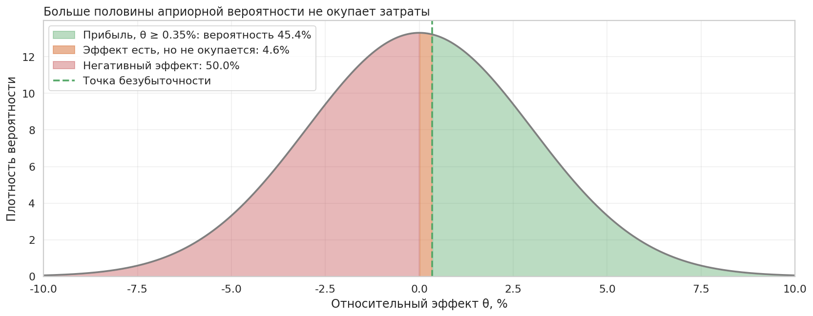
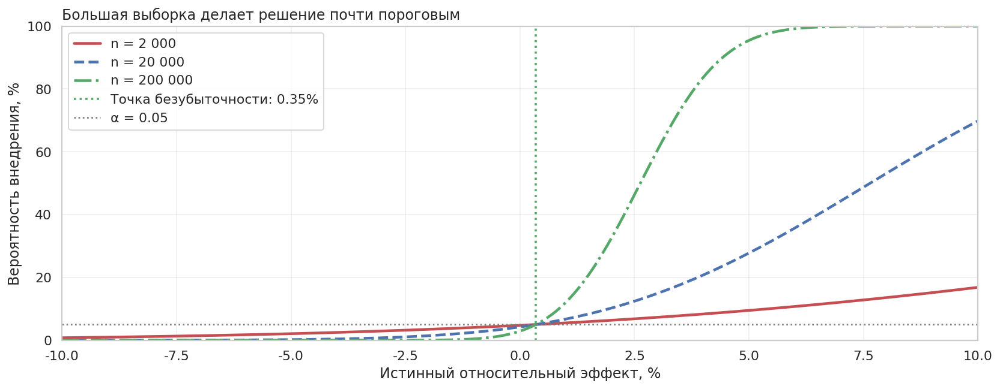
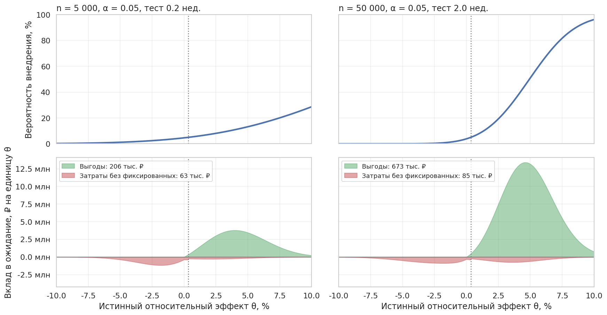
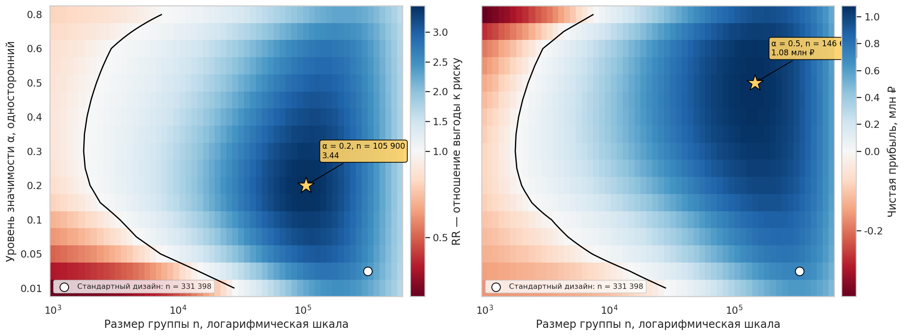
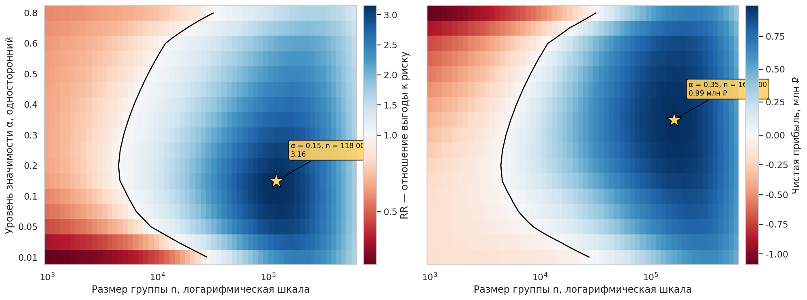
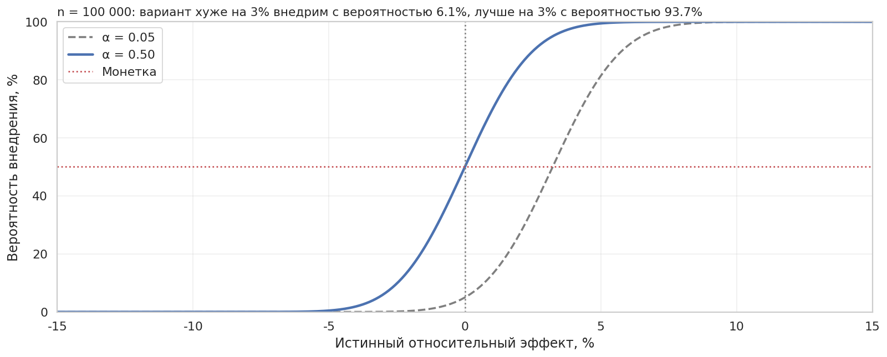
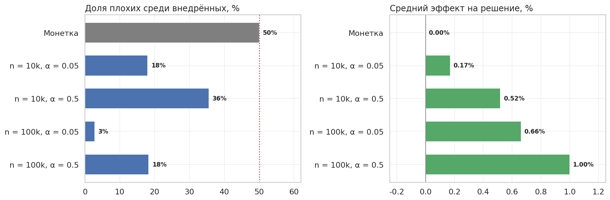
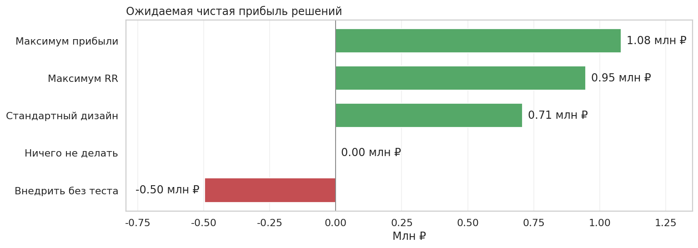

# Стоит ли тестировать

**Подбор уровня значимости α и размера выборки n — как экономическое решение.**

Тест — не «найти значимый эффект», а **максимизировать ожидаемую прибыль**: α и n подбираются под деньги конкретного кейса.

---

## Почему «α = 0.05, мощность 80%, MDE на глаз» — не догма

Традиционный рецепт игнорирует **структуру затрат и выгод** конкретного теста.

| Рычаг | Что на самом деле управляет |
| :--- | :--- |
| **α** | цена ложного внедрения → чем дешевле откат, тем мягче порог |
| **n** | сколько точности покупаем и **на сколько откладываем внедрение** |

- Оптимум зависит от цены ошибки (откат, необратимость) и горизонта.
- Дальше строим модель, которая подбирает α и n **под финансовый результат**.

---

## Сквозной кейс: интернет-магазин

Тестируем изменение **checkout-страницы** (влияет на вероятность покупки).

| Параметр | Значение |
| :--- | :--- |
| Базовая конверсия | 5% |
| Пользователей в неделю | 50 000 |
| Недельная выручка | 3 000 000 ₽ |
| Фиксированные затраты на тест | 180 000 ₽ |
| Внедрение · поддержка · откат | 120 000 ₽ · 20 000 ₽/мес · 250 000 ₽ |
| Горизонт планирования | 12 мес = 52 недели |

Допущение: **относительный рост конверсии = относительный рост выручки**.
Затронутая выручка ≈ 3 000 000 × 52 = **156 млн ₽**.

---

## Точка безубыточности и распределение ожиданий

$$\theta_{BE} = \frac{C_{test} + C_{impl} + C_{maint}}{R_{week}\cdot H}
= \frac{180\,000 + 120\,000 + 240\,000}{3\,000\,000 \times 52} \approx 0.35\%$$

Априорное распределение эффекта: $\pi(\theta) = \mathcal{N}(0,\ 3\%)$ — по истории похожих тестов.

Зелёное — окупается; **оранжевое — эффект есть, но не окупается**; красное — вред. «Успех» = $\theta > \theta_{BE}$, а не $\theta > 0$.

---

## Вероятность внедрения: решение против θ_BE

$$H_0:\ \theta \le \theta_{BE},\qquad H_1:\ \theta > \theta_{BE}$$

Внедряем при $\hat\delta > \delta_{BE} + z_{1-\alpha}\cdot SE$.

- **α односторонний** = P(внедрения при θ = θ_BE); двусторонний 0.05 ↔ односторонний 0.025.
- Вероятность внедрения **растёт с эффектом** → α = 0.5 ≠ монетка.

Все кривые проходят через θ = θ_BE с вероятностью α **при любом n**.

---

## Выгоды и затраты с поправкой на риск

$$Cost_{RA} = C_f + \int \pi(\theta)\Big[\underbrace{\max(-\theta R_{test},0)}_{\text{потеря в тесте}}
+ \big(\underbrace{\max(-\theta R_{post},0)}_{\text{потеря после}} + \underbrace{C_d(\theta)}_{\text{решение}}\big)\underbrace{POW(\theta)}_{\text{шанс внедрения}}\Big]d\theta$$

$$Gain_{RA} = \int \pi(\theta)\Big[\underbrace{\max(\theta R_{test},0)}_{\text{выгода в тесте}}
+ \big(\underbrace{\max(\theta R_{post},0)}_{\text{выгода после}} + G_d\big)POW(\theta)\Big]d\theta$$

$$RR = \frac{Gain_{RA}}{Cost_{RA}},\qquad Net = Gain_{RA} - Cost_{RA},\qquad ROI = RR - 1$$

Каждая неделя теста **съедает** неделю внедрения ($R_{post}$ убывает с $T$) — без этого «оптимальная» выборка росла бы бесконечно.

---

## Одинаковый α, разная выборка

| Дизайн | Выгоды | Затраты | Чистая прибыль | RR |
| :--- | ---: | ---: | ---: | ---: |
| n = 5 000 | 206 тыс ₽ | 243 тыс ₽ | **−37 тыс ₽** | 0.85 |
| n = 50 000 | 673 тыс ₽ | 265 тыс ₽ | **+408 тыс ₽** | 2.54 |

- **RR** — отдача на вложенный рубль (когда тестов много, ресурсов мало).
- **Net** — результат одного решения (когда важен абсолютный итог). Они выбирают **разные** дизайны.

---

## Тепловые карты α × n — главный результат

- **Максимум RR:** α = 0.2, n = 105 900 → RR 3.44, прибыль 0.95 млн ₽, 4.2 нед.
- **Максимум прибыли:** α = 0.5, n = 146 600 → RR 3.00, прибыль **1.08 млн ₽**, 5.9 нед.
- **Стандартный дизайн** (белая точка): α = 0.025, n = 331 400 → прибыль 0.71 млн ₽, 13.3 нед.

---

## Почему α > 0.05 оправдан

- Порог сравнивается **не с нулём, а с θ_BE**. Высокий α = готовность чаще внедрять варианты, которые лишь «выглядят выше θ_BE».
- Цена ошибки в кейсе **мала против годовой выручки** → порог ослаблен.
- Модель нейтральна к риску: смотрит на среднюю прибыль, а не на разброс исходов.

**Чувствительность:** дорогой откат 2 млн ₽ сдвигает оптимум к α = 0.35.

Чем дороже и необратимее ошибка — тем строже порог.

---

## Что значит α = 0.5: асимметрия внедрения

α — P(внедрения **при эффекте на границе θ_BE**), а не «вероятность ошибиться в любом решении».

Монетка внедряет 50% **независимо от эффекта**; тест с α = 0.5 внедряет, когда **оценка** выше порога → вероятность растёт с эффектом.

При n = 100 000: вариант **хуже на 3%** внедрим с 6.1%, **лучше на 3%** — с 93.7%.

---

## Качество роллаута: доля плохих внедрений

- **Монетка:** половина внедрённых — плохие, средний эффект 0.
- **α = 0.5:** внедряет столько же, но плохих 36% (n = 10k) → 18% (n = 100k).
- **α = 0.05:** плохих меньше (18% → 3%), но средний эффект ниже — хорошие варианты пропускаются.

α = 0.5 — не монетка, но защита от плохих вариантов — **за счёт выборки**, а не порога.

---

## Вердикт: стоит ли тестировать

| Решение | Чистая прибыль | RR | Длительность |
| :--- | ---: | ---: | ---: |
| Внедрить без теста | **−0.50 млн ₽** | — | — |
| Ничего не делать | 0 | — | — |
| Стандартный дизайн | +0.71 млн ₽ | 2.42 | 13.3 нед |
| Максимум RR | +0.95 млн ₽ | 3.44 | 4.2 нед |
| **Максимум прибыли** | **+1.08 млн ₽** | 3.00 | 5.9 нед |

Ценность теста — **асимметричный отбор**: при μ = 0 «внедрить без теста» убыточно, тест отсекает вредные варианты и оставляет хвост хороших.

---

## Требуемый n → длительность → трафик → деньги

Оптимум по прибыли: n = 146 600 на группу.

- Всего пользователей: 2 × 146 600 = **293 200**.
- При 50 000/нед → **5.9 недель (≈ 41 день)** ≈ 11% горизонта.
- Трафик есть с запасом; задержка внедрения уже учтена моделью как стоимость.

**Выводы**

1. α = 0.05 и мощность 80% — соглашение, а не бизнес-оптимум.
2. Дизайн подбирается под деньги: затраты, выручка, горизонт, $\pi(\theta)$.
3. Максимум RR и максимум прибыли — **разные** дизайны; цель выбираем явно.
4. Высокое α ≠ монетка, но и не безопасно: защиту даёт **выборка**.
5. Чем дороже ошибка — тем строже порог; проверяй чувствительность к входам.
